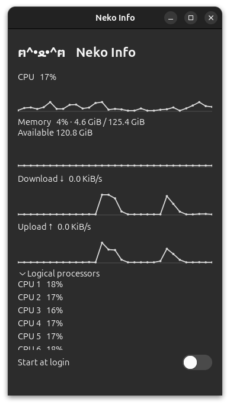

# Neko Info

A small native Linux desktop monitor. Keep CPU, memory and network activity in view, with a static cat and no browser engine.

[简体中文](README.zh-CN.md) · [Build and install](docs/building.md) · [FAQ](docs/faq.md) · [Testing status](docs/testing.md)



*User-provided screenshot from Ubuntu 24.04.5 LTS, GNOME 46.0. Processor details are expanded; the default view is more compact.*

## What it does

- CPU usage, memory used/available, and download/upload rates.
- Two-second sampling with 60 seconds of in-memory trends.
- Expandable, scrollable logical-processor details.
- Native GTK4 controls and desktop light/dark appearance integration.
- Optional **Start at login**, disabled by default.

Close the window to exit. It runs as an ordinary user, keeps one live application window per desktop session, and has no background restart service, telemetry or saved metric history.

This is a normal desktop window. Desktop pinning, process management, GPU/temperature/disk metrics, remote monitoring and animated mascots are outside this version. Resource-use benchmarks have not been measured yet.

## Install

The current development version is **2.0.0**. Build from source using the [Debian/Ubuntu or Arch instructions](docs/building.md). Distribution packages supply Python, GTK and the other dependencies; installation does not run pip.

| Platform | Status |
| --- | --- |
| Ubuntu 24.04.5 LTS, GNOME 46.0, GTK 4.14.5 | User-tested package installation, window display and live refresh; new screenshot supplied |
| Debian stable | CI package build/install and installed Xvfb smoke passed; GNOME/KDE desktop checks pending |
| Arch Linux | CI package build/install and installed Xvfb smoke passed; GNOME/KDE desktop checks pending |
| Other desktops / X11 / Wayland combinations | See the [validation matrix](docs/testing.md); no blanket compatibility claim |

There is no official Debian repository entry or AUR publication for this version. Building an installable package and publishing to distribution repositories are separate steps.

After installation, launch **Neko Info** from the application menu or run:

```sh
nekoinfo
```

For login startup, enable **Start at login** in the window. Disable it before uninstalling. The [FAQ](docs/faq.md#start-at-login) explains where the entry is stored.

## Compatibility

Linux launches default to GTK's Cairo renderer, following an Ubuntu report where EGL/Mesa initialization delayed startup by about 30 seconds. This affects only Neko Info; an explicit `GSK_RENDERER` remains respected. See [renderer troubleshooting](docs/faq.md#slow-startup-or-eglmesa-warnings).

The application gives only its login-switch images a nonzero font size to avoid a GTK 4.14 baseline issue triggered by zero-font theme rules. User theme files are never rewritten. The exact Ubuntu theme correction was confirmed by the user; the new application-local guard still needs confirmation on that machine. See [theme compatibility](docs/faq.md#gtkimage-baseline-warnings).

## Data and development

CPU is averaged over logical processors. Memory used is **total − available**; available includes reclaimable caches. Network aggregates non-loopback interfaces, so VPNs and bridges can count traffic more than once. [Details and limitations](docs/faq.md#understanding-the-readings).

Python 3.11+, GTK4, PyGObject, GI Cairo, pycairo and psutil are required. With distro runtime dependencies installed:

```sh
PYTHONPATH=src python3 -m nekoinfo
PYTHONPATH=src python3 -m unittest discover -s tests -v
```

Build, headless GUI checks and contribution guidance are in [building.md](docs/building.md). Reproducible checks and outstanding Linux validation are in [testing.md](docs/testing.md). Changes are tracked in [CHANGELOG.md](CHANGELOG.md).

## License and history

[MIT](LICENSE). Original author: Cocoa Oikawa. Existing icon artwork and attribution are preserved. The 2017 browser-based screenshot remains at [screenshot.jpg](screenshot.jpg); the main screenshot above shows the current native interface.
