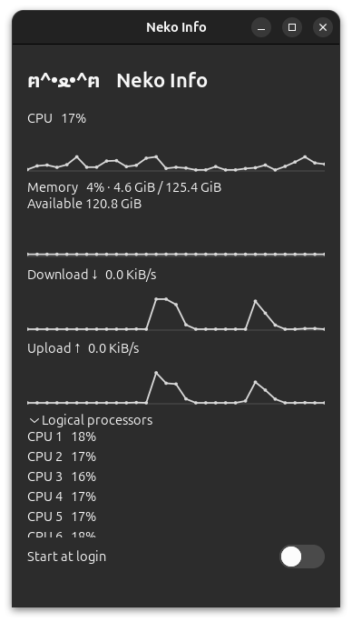

# Neko Info

轻量的 Linux 原生桌面状态工具：抬眼查看 CPU、内存和网络活动，保留一点猫咪的个性。

[English](README.md) · [构建与安装](docs/building.md) · [常见问题](docs/faq.md) · [验证记录](docs/testing.md)



*用户提供的 Ubuntu 24.04.5 LTS / GNOME 46.0 实机截图。图中已展开逻辑处理器详情，默认窗口更紧凑。*

## 功能

- CPU 占用、内存已用/可用量、网络上下行速率。
- 每两秒采样，展示最近一分钟趋势。
- 按需展开、可滚动的逻辑处理器详情。
- GTK4 原生控件、桌面深浅色偏好适配。
- 默认关闭的登录启动开关。

普通用户权限即可运行；关闭窗口就退出。指标历史只存内存，没有浏览器引擎、遥测或后台重启服务。当前版本采用普通窗口，暂不包含桌面固定、进程管理、GPU/温度/磁盘监控或持续动画。尚未公布资源占用实测数据。

## 安装与状态

当前开发版本为 **2.0.0**。请按[构建与安装说明](docs/building.md)从源码生成 Debian/Ubuntu 的 .deb，或使用 Arch 的 PKGBUILD。依赖通过发行版包管理器安装，不使用安装脚本执行 pip。

- **Ubuntu 24.04.5 LTS / GNOME 46.0 / GTK 4.14.5**：用户已实测安装、窗口显示与持续刷新，并提供新版截图。
- **Debian stable、Arch Linux**：已提供打包与 CI 配置，目标环境构建执行仍待验证。
- 其他桌面以及 X11/Wayland 组合：以[验证矩阵](docs/testing.md)为准。

当前版本尚未进入 Debian 官方仓库或发布到 AUR。

安装完成后，从应用菜单打开 Neko Info，或运行：

```sh
nekoinfo
```

窗口里的 **Start at login** 控制桌面登录启动，默认关闭，卸载前建议关闭。详见 [FAQ](docs/faq.md#start-at-login)。

## 已知兼容处理

Linux 默认使用 Cairo 渲染，以规避已实测的 EGL/Mesa 初始化延迟；用户明确指定的 GSK_RENDERER 会保留。这不会修改系统图形设置，也不代表软件渲染必然更省 CPU。

某些主题将开关字号设为 0，会在 GTK 4.14 上触发 GtkImage baseline 警告。应用仅为自身登录开关的内部图标设置非零字号，不改写用户主题。用户已验证主题单行修正有效；新增应用内处理仍待该 Ubuntu 机器复核。详见 [FAQ](docs/faq.md#gtkimage-baseline-warnings)。

## 数据口径

CPU 为各逻辑处理器占用率的平均值。内存已用量为“总量减可用量”，可用量包括部分可回收缓存。网络聚合非回环接口，VPN、桥接和虚拟接口可能重复计数，因此不等同于精确互联网带宽。

开发需要 Python 3.11+、GTK4、PyGObject、GI Cairo、pycairo 和 psutil。开发、测试、升级及卸载步骤见[构建说明](docs/building.md)。

保留原作者 Cocoa Oikawa 的 [MIT 许可证](LICENSE)与图标来源。[旧截图](screenshot.jpg)展示的是 2017 年的浏览器渲染版本。
